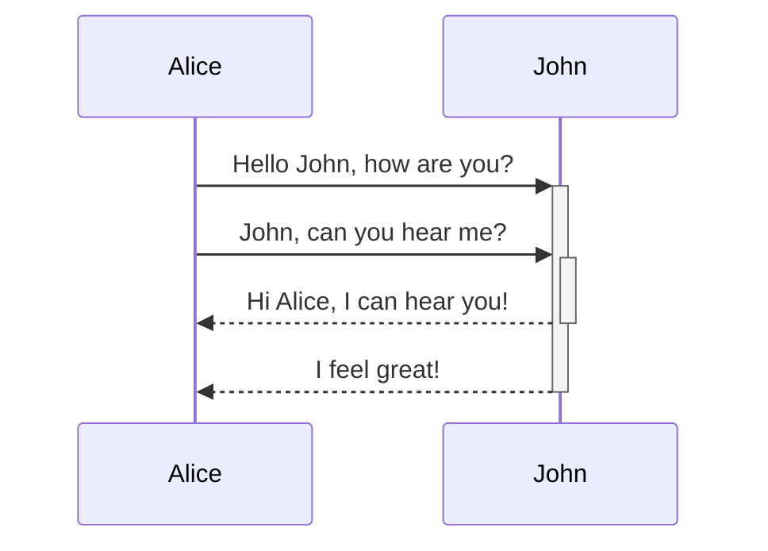
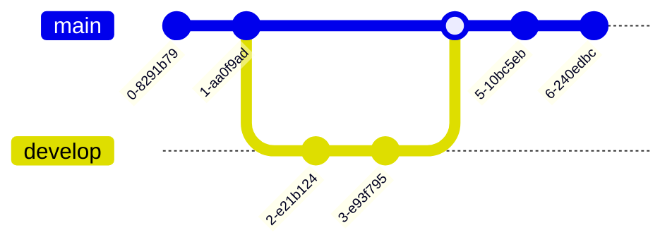
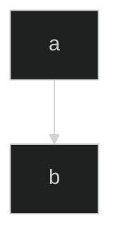
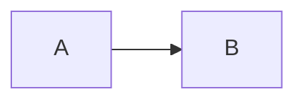

up:: "[[P_Advanced Slides]]"
Related:
	- [P_obsidian-slides-extended.md](P_obsidian-slides-extended.md)
	- "[[AS_Frontmatter Options]]"
	- "[[AS-Scrollbox]]"

[toc]

参考链接：
- 官方文档 [Mermaid — Advanced Slides](https://mszturc.github.io/obsidian-advanced-slides/markdown/mermaid/)
- [mermaid configuration](https://mermaid-js.github.io/mermaid/#/Setup)
- 同类问题：[mermaid#6424](https://github.com/mermaid-js/mermaid/issues/6424) · [mermaid#5252](https://github.com/mermaid-js/mermaid/issues/5252) · [quarto#12696](https://github.com/quarto-dev/quarto-cli/issues/12696)

# AS Mermaid

Slides Extended（原 Advanced Slides）用 reveal.js + 内置 `reveal.js-mermaid-plugin` 渲染 mermaid 代码块。Obsidian / VSCode 笔记预览走另一套管线，两边表现不一致时以 Slide 预览 / 导出 HTML 为准排查。

## 基本用法

````md
---
theme: beige
highlightTheme: css/vs2015.css
---


````


````md
---
theme: beige
highlightTheme: css/vs2015.css
---

#### Gitgraph Diagrams support


````


## Mermaid Configuration

可在幻灯片 YAML frontmatter 覆盖默认 mermaid 配置：

```md
---
mermaid:
  themeVariables:
    fontSize: 32px
  theme: 'forest'
---
```

单图配置不要用块内 `---` YAML（会与 slide 分隔符冲突），改用：



见 [reveal.js-mermaid-plugin](https://github.com/zjffun/reveal.js-mermaid-plugin)。


> [!info] 
> - @2026-08-27 Update 下述写在代码块里面的设置也支持了[✨ Align Mermaid rendering with Obsidian: empty lines, block-level config, and mermaidConfig theme option · Issue #332 · ebullient/obsidian-slides-extended](https://github.com/ebullient/obsidian-slides-extended/issues/332)
>     
>     ````
>     ```mermaid
>     ---
>     config:
>       theme: "base"
>       fontSize: 32px
>       mirrorActors: false
>       themeVariables:
>         textColor: "red"
>     ---
>     sequenceDiagram
>         actor U as User
>         participant C as Client (MCP Host)
>         participant M as MCP Server
>     
>         U->>C: Register MCP Server
>         C->>M: initialize (client info, protocol version)
>         M-->>C: supported features (tools, resources, prompts)
>         C->>M: request tool definitions (tools/list)
>         M-->>C: tool schemas (names, descriptions, parameters)
>     ```
>     ````


## as-no-scale

默认 Mermaid（`useMaxWidth: true`）输出 `svg[width="100%"]`，再被 `.block > .mermaid` / `scrollbox-y` 拉成栏宽，**整图缩小，字号视觉上变小**（不是改了 `font-size`）。

**必须**在图内（或 YAML `mermaid.flowchart`）设 `useMaxWidth: false`，让 SVG 写出像素宽。仅 CSS `as-no-scale` 盖不住属性 `width="100%"`。

`as-no-scale` 只把已是像素宽的 SVG 钉成 `max-content`、避免再被栏宽缩小；**不含 overflow**。滚动交给 [[AS-Scrollbox]]。挂 class 的两种写法都有效：

写法 A（闭合 `:::` 的 element annotation）：

````md
::: block



::: <!-- element class="scrollbox-x as-no-scale" -->
````

写法 B（HTML 包裹）：

````md
<div class="scrollbox-x as-no-scale">


</div>
````

YAML 全局（本 deck 所有 flowchart）：

```yaml
mermaid:
  flowchart:
    useMaxWidth: false
```

`<!-- slide class="as-no-scale" -->` 作用于该页全部 mermaid。

| 组合 | 效果 |
|------|------|
| `scrollbox-x as-no-scale` | 固有宽度 + 横向滚动（宽流程图） |
| `scrollbox as-no-scale` | 固有宽高 + 双向滚动 |
| `scrollbox-y as-no-scale` | 固有尺寸 + 纵滚。图比栏更宽时横溢会被 `overflow-x: hidden` 裁掉，宽图用 `scrollbox` / `scrollbox-x` |
| 仅 `as-no-scale` | 不缩；无滚动，可能画出格子 |

## 使用日志

### @2026-10-10 调大 fontSize 后节点文字垂直不居中（Marp 侧同病）

Marp deck（`20261009164855_gu`）用 `themeVariables: { fontSize: "18px" }` 调大字号后，节点文字整体偏下。在浏览器 DevTools 数值实测（mermaid 11.15.0）：

- **不是** fontSize 写在 `%%{init}%%` 还是外部 `mermaid.initialize` 的差异——两种写法实测结果完全一致。
- **根因**：Mermaid **量字高度 ≈ 每行 16.6 SVG 单位**（fontSize 18 时），实际渲染行高是内联 `line-height: 1.5 × 18 = 27px`。`foreignObject` 按量字结果定位标签 → 文字逐行下偏：单行 ≈0、两行 +5、三行 +10、圆柱 `[("…")]` +9.8。与上文「markdown 粗体吞字」同属**量字/绘制分叉**一类病。
- 宿主的段落 margin 会渗入 foreignObject 内 `<p>`（Marp 的 `p { margin-bottom: 16px }`），且量字阶段把它算进去了——实测清零后单行节点反而 +4.7 偏下，**不要**用 CSS 清宿主 margin。
- **有效修复**：渲染后按「字形块中心 ↔ 形状 bbox 中心」差值平移 `g.label`（完整脚本见 [[P_VSCode_Marp#调大 fontSize 后节点文字不垂直居中]]）。「调回原字号」不解决问题，只是让错位变小。

### @2026-08-11 flowchart 节点文字被吞

Obsidian / VSCode 预览正常；Slides Extended 预览与导出 HTML 中，flowchart 长标签被节点矩形裁切（右侧缺字）。短文案正常；标签末尾 `&nbsp;` 有时能撑宽 → **框宽算窄**，非源码丢字。本地插件 slides-extended 2.4.2。在 `20260809162444_wang_slides_extended` 上验证：`minScale`/`maxScale: 1` **无效**。

**原因（2026-08-11 初判，2026-08-19 修订）**：

1. **主因（已核实）**：flowchart 节点框按 **regular** 文本量宽；反引号 markdown 的 `**bold**` / `*em*` 渲染后更宽（粗体约 +8–12%），`foreignObject` 默认 `overflow: hidden` 从右侧裁掉。对照：同一句不加粗则完整。常与 `htmlLabels: false` 叠加——量字走 SVG/plain，绘制仍走 HTML `<strong>`。
2. **次因**：`flowchart.wrappingWidth`（默认约 **200**）过窄时，长标签也会被裁（同类 [mermaid#6424](https://github.com/mermaid-js/mermaid/issues/6424)）。reveal 正文字号渗入 htmlLabels 会放大此问题，但**不是**「有粗体才吞、无粗体不吞」的充分条件。
3. 社区提到的 reveal `transform: scale` 量字偏差在部分环境存在，但**不是本稿主因**。

**不要**在 `AS_basic.css` 里钉死 `.mermaid { font-size: … }`：会盖掉 YAML / `%%{init}%%` 的 `themeVariables.fontSize`。

**修复（按推荐顺序）**：

1. **CSS 放开裁切（已写入 [`AS_basic.css`](../assets/css/AS_basic.css)）** — 只改 overflow，不改字号：

	```css
	.reveal .mermaid .node,
	.reveal .mermaid .label,
	.reveal .mermaid foreignObject {
		overflow: visible;
	}
	```

	粗体可能略超出矩形；字仍完整。加载了 `AS_basic.css` 的稿件自动生效；改后需**刷新** Slide 预览。

2. **用 markdown 粗体时不要关 `htmlLabels`** — `htmlLabels: false` 让量字与 `<strong>` 绘制分叉，吞字更易复现。需要 `**bold**` 就保持默认 `htmlLabels: true`（或不写该键）。

3. **加大 `wrappingWidth`（仅长句换行/裁切时）** — 不能写进 CSS，见 frontmatter / `%%{init}%%`。字号用 `themeVariables.fontSize`，不要靠主题 CSS 写死：

	```yaml
	mermaid:
	  flowchart:
	    wrappingWidth: 1000
	  themeVariables:
	    fontSize: 25px
	    fontFamily: '"Times New Roman", "Microsoft YaHei", "PingFang SC", Arial, sans-serif'
	```

	单图：

	```mermaid
	%%{init: {"flowchart": {"wrappingWidth": 1000}, "themeVariables": {"fontSize": "25px"}}}%%
	graph TD
	  A["..."]
	```

4. **内容侧** — `<br>` / markdown 多行、缩短文案、粗体行末 `&nbsp;` 撑宽节点框；避免超长无空格英文串

5. **离线出图** — Mermaid Live / CLI 导出 SVG、PNG 再嵌入

6. **（可选）** `minScale`/`maxScale: 1` 或 [反缩放 gist](https://gist.github.com/ftes/50d60107043093ba3624cae38c5dffaf) — 仅当仍怀疑 scale 时再试，**不能替代方案 1–3**

| 场景 | 建议 |
|------|------|
| 常规幻灯片（已用 AS_basic） | 方案 1；markdown 粗体勿关 htmlLabels |
| 极长单行 / 无空格串 | 方案 3 + 方案 4 |
| 图极复杂、导出要绝对正确 | 方案 5 |

### @2026-08-19 markdown 粗体吞字

在 `20260809162444_wang_pre` 上对照：markdown 粗体节点（如 Manipulative intent）右侧缺字，同句不加 `** **` 则完整。`wrappingWidth: 4000` 与 `themeVariables.fontSize: 40px` 仍复现 → **不是**字号 CSS / wrappingWidth 主因，而是 **markdown 粗体比量字更宽 + foreignObject 裁切**。

此前用 `--as-mermaid-font-size: 16px` 钉死图内字号也能「看起来修好」（显示变小，粗体挤回框内），但 YAML / 块内 `fontSize` 会失效，**已从 `AS_basic.css` 撤掉**。现在只保留 `overflow: visible`。

用 markdown 样式时请去掉 `%%{init: {"flowchart": {"htmlLabels": false}}}%%`；该开关与反引号 markdown 叠用会稳定触发本问题。

### @2026-08-19 as-no-scale 取消 SVG 撑满缩放

宽 flowchart 在栏内被 `width="100%"` 缩小后字过小。根因是 Mermaid 默认 `useMaxWidth: true`，不是 class 没挂上。`as-no-scale` + `scrollbox-*` 的写法 A（`::: <!-- element class="scrollbox-x as-no-scale" -->`）与写法 B（`<div class="…">`）**都有效**；须同时 `%%{init: {"flowchart": {"useMaxWidth": false}}}%%`。见上文 [[#as-no-scale]]。

### @2026-08-11 Local theming / 块内 YAML

[✨ Local theming support for Mermaid · Issue 294 · ebullient/obsidian-slides-extended](https://github.com/ebullient/obsidian-slides-extended/issues/294)

块内 YAML frontmatter（`---` config）与默认 slide 分隔符冲突，改用 `%%{init: ...}%%`。

### @2025-02-27 部分图不显示 / 过小

[🐛 some mermaid diagrams not working · Issue 113](https://github.com/ebullient/obsidian-slides-extended/issues/113) — 可用 `.mermaid { width: 100%; height: auto; }`（插件后续已写入默认 CSS）

### Kanban

- [Kanban to Slides · Discussion 70](https://github.com/ebullient/obsidian-slides-extended/discussions/70) Dec 2, 2024
