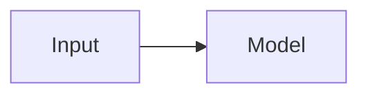
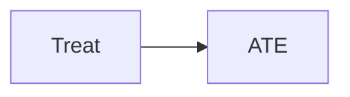
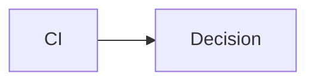

<!-- slide id="0" class="grid-align-restore cover" template="[[AsTp-Cover]]" -->

::: title

# Slides Extended_Basic Showcase

:::

::: content

###### ASTp 模板与 AS_basic 样式演示

| 汇报人： | 吕小布 |
|:--:|:--:|
| 导师： | 顾锋教授 |
| 单位： | Antai School |

:::

---

## 封面

配合 `[[AsTp-Cover]]`；`center: false` 时 slide 加 **`grid-align-restore cover`**。`cover` 清除全部标题 `::before`/`::after`（含 subtitle 的 `##` 下划线），配色 token 在 `AS_red.css` / `AS_blue.css`（`--as-cover-*`），规则见 `AS_basic.css` §15。

槽位：**title**（`#`）、可选 **subtitle**（`##`）、**content**（汇报人、日期等）。槽位写法见 [[AS-Templates]]。

> 说明页正文**勿写**会被解析的三冒号槽字面量；仅在实际分块 slide 中使用。本 deck 按真实组会路径讲解：封面 → 目录 → 渡页 → 导航 → Grid → 列表卡片 → 表格滚动 → 专项 → 尾页。**nav 仅出现在「导航壳」专节与 scrollbox 写法 A**。

---

<!-- slide template="[[ASTp-toc-a]]" -->

::: title

## 目录

:::

::: items

- 目录模板
- 渡页
- 导航壳
- CSS 面板 / Grid 模板
- 列表与卡片
- 表格与滚动
- 专项版式
- 尾页

:::

---

## 目录模板

`ASTp-toc-a`：`title` + `items`。`ASTp-toc-b`：`header`（可多行 / logo）+ `items`。上一页为本 deck 目录（toc-a）；下一页为 toc-b 示例。

---

<!-- slide template="[[ASTp-toc-b]]" -->

::: header

目录

CONTENTS

:::

::: items

- 第一章：背景与目标
- 第二章：方法与过程
- 第三章：结果与建议
- 第四章：总结与展望

:::

---

## 渡页

`trans_a` / `trans_b`：均在 `[[ASTp-grid-lr]]` 上加 class；`center: false` 时加 `grid-align-restore`。**勿**在 **content** 槽写正文，只用 **left** / **right**（右栏供 `trans_b` 裁图）。

| class | 模板 | 装饰 |
|:------|:-----|:-----|
| `trans_a` | `[[ASTp-grid-lr]]` | 页面正中主题色竖线 |
| `trans_b` | `[[ASTp-grid-lr]]` | 右半区三层平行斜边：图片窗 + 白带 + 底边红梯形 |

`trans_b` token：`--as-trans-b-base-span`（斜率）、`--as-trans-b-band-width`（白带宽）、`--as-trans-b-shift`（图片左缘右移）、`--as-trans-b-mask-bg`（白带色）。

---

<!-- slide class="trans_a grid-align-restore" template="[[ASTp-grid-lr]]" -->

::: left

# trans_a — 章节过渡

左栏标题

:::

::: right

:::

---

<!-- slide class="trans_b grid-align-restore" template="[[ASTp-grid-lr]]" -->

::: left

# trans_b — 三层平行斜边

:::

::: right

 <!-- element height="100%" -->

:::

---

## 导航壳 ASTp-nav-*

SJTU 主题 deck 用 `ASTp-nav-shell` 或 `ASTp-nav-*`（内部 chain shell）做 header/footer。每页显式 `template=`，无需 `defaultTemplate`。嵌套见 [[AS-Templates]]；CSS 见 [as_basic.md](../themes/as_basic.md)。

| | inline Grid | block 分栏 | nav 灵活导航 |
|:--|:--|---|:--|
| 模板 | 仅 A | A + B（B chain A） | `ASTp-nav-shell` / `ASTp-nav-*` |
| MD | inline `grid` | left / right 槽 | **header** / **footer** + layout 槽 |
| 章节高亮 | — | — | `==[章节名](#id)==` |

- **Header**：首行 deck 短标题（`p`，链 `#0`），空行后为章节 nav 列表
- **Footer**：三项 `li`（汇报人 / 短标题 / 日期）
- 下列各模板**各演示一页**；其后章节不再套 nav

---

<!-- slide id="nav-shell" template="[[ASTp-nav-shell]]" -->

::: header
[Layout Showcase](#0)

- ==[导航壳](#nav-shell)==
- [Grid 分栏](#nav-lr)
- [列表与卡片](#nav-lr)
:::

::: footer
- 吕小布
- ASTp Layout Showcase
- 2026/07/14
:::

## nav-shell — 全宽正文

纯内容页：`template="[[ASTp-nav-shell]]"`。header / footer 由槽提供；正文直接写在页面（进入 shell 的 content）。

- 适合长叙述、单表、单图
- 分栏请改用下方 `ASTp-nav-grid-*`

---

<!-- slide id="nav-lr" template="[[ASTp-nav-grid-lr]]" -->

::: header
[Layout Showcase](#0)

- [导航壳](#nav-shell)
- ==[nav-grid-lr](#nav-lr)==
- [cols2-64](#nav-64)
:::

::: footer
- 吕小布
- ASTp Layout Showcase
- 2026/07/14
:::

::: left

## nav-grid-lr（50 / 50）

左栏正文示例。

- 要点 A
- 要点 B

:::

::: right

:::

---

<!-- slide id="nav-64" template="[[ASTp-nav-grid-cols2-64]]" -->

::: header
[Layout Showcase](#0)

- [nav-grid-lr](#nav-lr)
- ==[cols2-64](#nav-64)==
- [nav-tb](#nav-tb)
:::

::: footer
- 吕小布
- ASTp Layout Showcase
- 2026/07/14
:::

::: left

## nav-grid-cols2-64（约 55 / 40）

左宽右窄；宽表 + 配图的常见组合（scrollbox 写法 A 也常用此模板）。

:::

::: right

:::

---

<!-- slide id="nav-tb" template="[[ASTp-nav-grid-tb]]" -->

::: header
[Layout Showcase](#0)

- [cols2-64](#nav-64)
- ==[nav-tb](#nav-tb)==
- [nav+rows](#nav-r12)
:::

::: footer
- 吕小布
- ASTp Layout Showcase
- 2026/07/14
:::

::: top

### nav-grid-tb — 上区

顶部全宽：问题陈述或关键图。

:::

::: content

### 下区 content

下方主内容区（模板槽名为 **content**，非 bottom）。

- 结论 A
- 结论 B

:::

---

<!-- slide id="nav-r12" template="[[ASTp-nav-shell]]" class="rows-1-2" -->

::: header
[Layout Showcase](#0)

- [nav-tb](#nav-tb)
- ==[nav+rows](#nav-r12)==
- [壳结束](#nav-r12)
:::

::: footer
- 吕小布
- ASTp Layout Showcase
- 2026/07/14
:::

## nav-shell + rows-1-2

header/footer 用 shell；正文区用 CSS 面板（`as-body` 为 grid 宿主）。top=`auto`，左右=`1fr`。

::: block
顶部全宽（高度随内容）
::: <!-- element class="tdiv" -->

::: block
左下（占剩余高度）
::: <!-- element class="ldiv" -->

::: block
右下
::: <!-- element class="rdiv" -->

---

## Grid 分栏：双路径

每种多栏布局依次展示：**先 CSS 面板**（slide class + block + `ldiv`/`rdiv`…），**再 template + grid**（`ASTp-grid-*` + left/right 槽）。说明页正文勿写三冒号字面量（见文首 warning）；仅在实际分块 slide 里使用槽 / block。

| 布局 | CSS（路径 B） | 模板（路径 A） |
|:-----|:--------------|:---------------|
| 1:1 双栏 | `cols-2` | `[[ASTp-grid-cols2]]` / `[[ASTp-grid-lr]]` |
| 三栏 | `cols-3` | `[[ASTp-grid-cols-3]]` |
| 7:3 | `cols-2-73` | `[[ASTp-grid-cols2-73]]` |
| 6:4 | `cols-2-64` | `[[ASTp-grid-cols2-64]]` |
| 3:7 | `cols-2-37` | `[[ASTp-grid-cols2-37]]` |
| 4:6 | `cols-2-46` | `[[ASTp-grid-cols2-46]]` |
| 上+下 | `rows-2` | —（无模板） |
| 上+左右 | `rows-1-2` | —；nav 用 `ASTp-nav-shell` + 该类 |
| 左右+下 | `rows-2-1` | — |

CSS：`cols-*` 分栏行=`auto`（等高=最高内容）；`rows-*` 的 bottom 或左右带=`1fr`。模板：固定 `%` grid。勿无模板写 left/right 槽；勿在模板内嵌 `<split>`（[[AS-Templates]]）。面板写法见 [[AS-Block Comments]]。

---

## 1:1 双栏 — CSS

`class="cols-2"`：顶行 heading（`auto`）+ 左右行 `auto`（等高取最高栏内容）。标题写在 slide 根级。

---

<!-- slide class="cols-2" -->

## cols-2（CSS）

::: block

- 左栏要点 A
- 左栏要点 B

::: <!-- element class="ldiv" -->

::: block

| 指标 | 数值 |
|:---|---:|
| A | 12 |
| B | 34 |

::: <!-- element class="rdiv" -->

---

## 1:1 双栏 — 模板 grid-cols2

`template="[[ASTp-grid-cols2]]"`：左右各 50% 绝对 grid。标题写在 **left / right 槽内**（与 CSS 顶行 heading 不同）。

---

<!-- slide template="[[ASTp-grid-cols2]]" -->

::: left

## cols2 (1:1)

- 左栏要点 A
- 左栏要点 B
- 左栏要点 C

:::

::: right

| 指标 | 数值 |
|:---|---:|
| A | 12 |
| B | 34 |
| C | 56 |

:::

---

## 1:1 双栏 — 模板 grid-lr

`[[ASTp-grid-lr]]`：左右约 45% + 间隙；整高分栏，标题在槽内。渡页 `trans_a` / `trans_b` 也挂此模板。

---

<!-- slide template="[[ASTp-grid-lr]]" -->

::: left

## grid-lr (1:1)

图 A

:::

::: right

图 B

:::

---

## 三栏 — CSS

`class="cols-3"`：heading + left / middle / right；分栏行 `auto`（等高=最高内容）；整块垂直居中（AS `left`），栏内文字水平靠左。

---

<!-- slide class="cols-3" -->

## cols-3（CSS）

::: block
### 左
- A
- B
::: <!-- element class="ldiv" -->

::: block
### 中
- C
- D
::: <!-- element class="mdiv" -->

::: block
### 右
- E
- F
::: <!-- element class="rdiv" -->

---

## 三栏 — 模板

`template="[[ASTp-grid-cols-3]]"`：left / middle / right 槽。

---

<!-- slide template="[[ASTp-grid-cols-3]]" -->

::: left

### 左
- A
- B

:::

::: middle

### 中
- C
- D

:::

::: right

### 右
- E
- F

:::

---

## 7:3 — CSS

`class="cols-2-73"`：左 7fr / 右 3fr。

---

<!-- slide class="cols-2-73" -->

## cols-2-73（CSS）

::: block

宽列正文：适合长文本、图表说明或多层列表。

- 第一部分
- 第二部分
- 第三部分

::: <!-- element class="ldiv" -->

::: block

窄列补充：

- 结论 1
- 结论 2

::: <!-- element class="rdiv" -->

---

## 7:3 — 模板

`template="[[ASTp-grid-cols2-73]]"`。

---

<!-- slide template="[[ASTp-grid-cols2-73]]" -->

::: left

## cols2-73 (7:3)

宽列正文：适合长文本、图表说明或多层列表。

- 第一部分
- 第二部分
- 第三部分

:::

::: right

窄列补充：

- 结论 1
- 结论 2

:::

---

## 6:4 — CSS

`class="cols-2-64"`：左文右图常见比。

---

<!-- slide class="cols-2-64" -->

## cols-2-64（CSS）

::: block

左宽右窄；亦可左文右图。

- 子要点一
- 子要点二

::: <!-- element class="ldiv" -->

::: block

::: <!-- element class="rdiv" -->

---

## 6:4 — 模板

`template="[[ASTp-grid-cols2-64]]"`。nav 变体见前文 `ASTp-nav-grid-cols2-64`。

---

<!-- slide template="[[ASTp-grid-cols2-64]]" -->

::: left

## cols2-64 (6:4)

左宽右窄；亦可左文右图。

- 子要点一
- 子要点二

:::

::: right

:::

---

## 3:7 — CSS

`class="cols-2-37"`：左窄（目录）/ 右宽（正文）。

---

<!-- slide class="cols-2-37" -->

## cols-2-37（CSS）

::: block

- 目录一
- 目录二

::: <!-- element class="ldiv" -->

::: block

右侧主体内容区域。

::: <!-- element class="rdiv" -->

---

## 3:7 — 模板

`template="[[ASTp-grid-cols2-37]]"`。

---

<!-- slide template="[[ASTp-grid-cols2-37]]" -->

::: left

## cols2-37 (3:7)

- 目录一
- 目录二

:::

::: right

右侧主体内容区域。

:::

---

## 4:6 — CSS

`class="cols-2-46"`：左摘要 / 右主叙述。

---

<!-- slide class="cols-2-46" -->

## cols-2-46（CSS）

::: block

左侧摘要区。

::: <!-- element class="ldiv" -->

::: block

右侧主叙述区。

::: <!-- element class="rdiv" -->

---

## 4:6 — 模板

`template="[[ASTp-grid-cols2-46]]"`。

---

<!-- slide template="[[ASTp-grid-cols2-46]]" -->

::: left

## cols2-46 (4:6)

左侧摘要区。

:::

::: right

右侧主叙述区。

:::

---

## 上+下 — CSS（仅路径 B）

`class="rows-2"`：top=`auto`，bottom=`1fr`。已无对应 `ASTp-grid-rows-*` 模板。

---

<!-- slide class="rows-2" -->

## rows-2 — 上 + 下

::: block
上区（高度随内容）
::: <!-- element class="tdiv" -->

::: block
下区（占剩余高度）
::: <!-- element class="bdiv" -->

---

## 上+左右 — CSS（仅路径 B）

`class="rows-1-2"`：top=`auto`，左右=`1fr`。带导航见前文 nav-shell + 该类。

---

<!-- slide class="rows-1-2" -->

## rows-1-2 — 上 + 左右

::: block
左下（占剩余）
::: <!-- element class="ldiv" -->

::: block
右下
::: <!-- element class="rdiv" -->

---

## 左右+下 — CSS（仅路径 B）

`class="rows-2-1"`：左右带=`auto`，bottom=`1fr`。

---

<!-- slide class="rows-2-1" -->

## rows-2-1 — 左右 + 下

::: block
左上（高度随内容）
::: <!-- element class="ldiv" -->

::: block
右上
::: <!-- element class="rdiv" -->

::: block
底部全宽（占剩余）
::: <!-- element class="bdiv" -->

---

## 列表与卡片

以下均为 **slide class**（可无模板）。`list-grid` 列比 modifier、`fancy-ol-*` / `fglass`、`list-flex-*`、`list-card-grid`。任意内容两列见专项里的 `g-columns`。

| 族 | class | 要点 |
|:---|:------|:-----|
| 分列 | `list-grid` + `--1-2` / `--3` / … | 列表项进 CSS Grid 列 |
| 花式序号 | `fancy-ol-sq` / `fancy-ol-ci` | 方/圆序号；可与 list-grid、`fglass` 组合 |
| Flex | `list-flex-row` / `list-flex-col` / `list-flex-step` | 横/纵卡片；step=有序步骤图 |
| 卡片 | `list-card-grid` + `--icon` / `--ordered` / … | R×C 卡片矩阵 |

---

<!-- slide class="list-grid fancy-ol-sq" -->

## list-grid + fancy-ol-sq（默认 2 列）

1. 要点 Alpha
2. 要点 Beta
3. 要点 Gamma
4. 要点 Delta
5. 要点 Epsilon
6. 要点 Zeta

---

<!-- slide class="list-grid list-grid--3" -->

## list-grid--3

- 列 A · 项 1
- 列 B · 项 2
- 列 C · 项 3
- 列 A · 项 4
- 列 B · 项 5
- 列 C · 项 6

---

<!-- slide class="list-grid list-grid--1-2 fglass" -->

## list-grid--1-2 + fglass

1. 窄列条目
2. 宽列条目
3. 窄列条目
4. 宽列条目

左 1 : 右 2；`fglass` 毛玻璃底。

---

<!-- slide class="fancy-ol-ci" -->

## fancy-ol-ci — 圆形序号（含嵌套）

嵌套子列表时序号与首行标题应**同行**（`AS_basic.css` §13）。

1. **测量缺口**
	- 连续量表尚未建立
	- ➔ 需要 PIS
2. **结果缺口**
	- Conversion / Engagement 方向异效未检
3. **机制缺口**
	- 注意力 vs 抗拒双路径并行
4. **场域缺口**
	- 短视频注意力稀缺放大效应

---

## Flex 列表

`list-flex-row` / `list-flex-col`：横/纵弹性卡片（见 [[css_AS列表横向、纵向逐步显示]]）。`list-flex-step`：横排有序步骤，`01`/`02` 与首行标题分离。

---

<!-- slide class="list-flex-row" -->

### list-flex-row

- 输入 <!-- element class="fragment" -->
- 处理 <!-- element class="fragment" -->
- 输出 <!-- element class="fragment" -->

---

<!-- slide class="list-flex-col" -->

### list-flex-col

- 问题界定 <!-- element class="fragment" -->
- 方案比选 <!-- element class="fragment" -->
- 落地验证 <!-- element class="fragment" -->

---

<!-- slide class="list-flex-step" -->

### list-flex-step

1. 需求确认
	1. 拆成可执行的输入、输出和约束
2. 方案设计
	1. 每一步放进同一行，宽度均分
3. 结果交付
	1. 编号与首行文字分开控制

---

## 卡片矩阵

`list-card-grid` + 列数 / 样式 modifier（`AS_basic.css` ~494–947）。行数由项数自动换行。

| class | 效果 |
|:--|:--|
| `list-card-grid` | base，默认 2 列 |
| `--3` / `--4` | 显式列数 |
| `--icon` | 无序；符号行后空一行，次级粗体标题 |
| `--ordered` | 有序，左侧 01/02 |
| `--tint` | pastel 底色循环 |
| `--inline` | 序号与标题同行 |
| `--badge` | 顶边空心圆环徽章 |
| `--accent-odd` + `--accent-even` | 顶栏按行交替（配 `--2`/`--3`） |

---

<!-- slide class="list-card-grid list-card-grid--icon" -->

### 无序 2×2（icon）

- ✓

	- **可用性**
	- 用户能否完成核心任务？
- ✓

	- **可靠性**
	- 高频使用下是否稳定？
- ✓

	- **安全合规**
	- 权限是否最小化？
- 🙂

	- **运营闭环**
	- 反馈是否能进入迭代？

---

<!-- slide class="list-card-grid list-card-grid--ordered list-card-grid--tint" -->

### 有序 + tint

1. **说清业务场景**
	- 用户是谁？痛点是什么？
2. **定义输入输出**
	- 需要哪些数据？
3. **拆出功能模块**
	- 页面、按钮、规则
4. **标注优先级**
	- MVP 先交付什么？

---

<!-- slide class="list-card-grid list-card-grid--3 list-card-grid--ordered list-card-grid--inline list-card-grid--accent-odd list-card-grid--accent-even" -->

### 有序 2×3（inline + accent）

1. **投研风控**
	- 公告 / 新闻 → 风险提示
2. **知识库问答**
	- 内部文档检索
3. **合规审查**
	- 条款自动比对
4. **客户服务**
	- 工单分类与回复
5. **数据分析**
	- 自然语言出图
6. **流程自动化**
	- 跨系统编排

---

<!-- slide class="list-card-grid list-card-grid--4 list-card-grid--badge" -->

### 徽章卡片（4 列）

- :disappointed:

	- **01.输入**
	- 正文一句
- :cat:

	- **02.处理**
	- 正文一句
- :rocket:

	- **03.输出**
	- 正文一句
- :white_check_mark:

	- **04.闭环**
	- 正文一句

---

## 表格与滚动

`AS_basic.css` §8（`.academia` / `.table-fit`）、§9.5（`scrollbox*`）、§9.6（`gallery`）。宽/长表须滚动容器；字号随栏缩放用 `table-fit`；多图/mermaid 横排用 `gallery`。详解 [[AS-Scrollbox]]。

| class | 作用 |
|:--|:--|
| `academia` | 学术表边框、表头、斑马纹 |
| `scrollbox` | 双向滚 |
| `scrollbox-x` | 横滚：宽表 |
| `scrollbox-y` | 纵滚：长表 |
| `gallery` | 长廊：图 / SVG / mermaid 等横排横滚（**独立于** `scrollbox-*`） |
| `table-fit` | `font-size` 按 `cqh`/`cqw` 缩放 |

**写法**：A — 模板槽闭合行 element annotation（本节保留一页 nav-grid）；B — 槽或正文内 `
` / `
`。下列 B / academia / table-fit **无 nav**（`ASTp-fixedtitle` 提供高度链）。

---

<!-- slide class="academia" -->

## academia — 学术表

| 指标 | 条件 A | 条件 B | 条件 C | 备注 |
|:-----|------:|------:|------:|:-----|
| Conversion | 0.12 | 0.18 | 0.09 | 注册转化 |
| Engagement | 0.41 | 0.33 | 0.52 | 互动率 |
| Attention | 2.1s | 3.4s | 1.6s | 停看时长 |
| Resistance | 0.22 | 0.31 | 0.15 | 心理抗拒 |

裸 slide + `class="academia"` 即可；无需导航壳。

---

<!-- slide template="[[ASTp-fixedtitle]]" class="academia" -->

::: title

## scrollbox-x — 宽表横滚（写法 B）

:::

::: body

标题在 fixedtitle；表在 `scrollbox-x` 内横滚（完整 `display:table`，列宽对齐）。

| 策略代号 | treated/control | ATE | 95% CI | p | 场域 | 声音 aggressive | Conversion | Engagement | Notes |
|:---------|----------------:|----:|-------:|--:|:-----|----------------:|-----------:|-----------:|:------|
| SoftSell-base | 1200/1180 | 0.04 | [-0.01, 0.09] | 0.12 | 短视频 | 低 | ↑ | ↑ | 基线软销 |
| MidPush-A | 980/990 | 0.11 | [0.03, 0.19] | 0.01 | 短视频 | 中 | ↑↑ | → | 中度推进 |
| HardSell-hi | 860/870 | -0.08 | [-0.16, 0.00] | 0.05 | 短视频 | 高 | ↓ | ↓↓ | 强推触发抗拒 |
| CrossMedia-TV | 540/530 | 0.02 | [-0.06, 0.10] | 0.61 | 传统媒体 | 中 | → | → | 对照场域 |
| LiveRoom-peak | 1500/1480 | 0.15 | [0.07, 0.23] | 0.00 | 直播 | 高 | ↑↑ | ↑ | 峰值流量 |

| 策略代号          | treated/control |   ATE |        95% CI |    p | 场域   | 声音 aggressive | Conversion | Engagement | Notes  | Notes  | Notes  |
| :------------ | --------------: | ----: | ------------: | ---: | :--- | ------------: | ---------: | ---------: | :----- | :----- | :----- |
| SoftSell-base |       1200/1180 |  0.04 | [-0.01, 0.09] | 0.12 | 短视频  |             低 |          ↑ |          ↑ | 基线软销   | 基线软销   | 基线软销   |
| MidPush-A     |         980/990 |  0.11 |  [0.03, 0.19] | 0.01 | 短视频  |             中 |         ↑↑ |          → | 中度推进   | 中度推进   | 中度推进   |
| HardSell-hi   |         860/870 | -0.08 | [-0.16, 0.00] | 0.05 | 短视频  |             高 |          ↓ |         ↓↓ | 强推触发抗拒 | 强推触发抗拒 | 强推触发抗拒 |
| CrossMedia-TV |         540/530 |  0.02 | [-0.06, 0.10] | 0.61 | 传统媒体 |             中 |          → |          → | 对照场域   | 对照场域   | 对照场域   |
| LiveRoom-peak |       1500/1480 |  0.15 |  [0.07, 0.23] | 0.00 | 直播   |             高 |         ↑↑ |          ↑ | 峰值流量   | 峰值流量   | 峰值流量   |

:::

---

<!-- slide template="[[ASTp-fixedtitle]]" class="academia" -->

::: title

## scrollbox-y — 长表纵滚（写法 B）

:::

::: body

| # | Y | ATE | 95% CI | p |
|:--|:--|----:|-------:|--:|
| 1 | `log_likes` | 0.12 | [-0.02, 0.26] | 0.09 |
| 2 | `log_comments` | -0.08 | [-0.21, 0.05] | 0.22 |
| 3 | `log_shares` | 0.19 | [0.04, 0.34] | 0.01 |
| 4 | `log_favorites` | 0.05 | [-0.10, 0.20] | 0.51 |
| 5 | `log_estimated_sales_volume` | -0.65 | [-2.82, 1.53] | 0.56 |
| 6 | `log_estimated_sales_amount` | -0.75 | [-3.11, 1.61] | 0.53 |
| 7 | `play_duration_s` | 11.2 | [3.1, 19.3] | 0.01 |
| 8 | `click_rate` | -0.14 | [-0.27, -0.01] | 0.03 |
| 9 | `complete_rate` | 0.03 | [-0.06, 0.12] | 0.48 |
| 10 | `follow_rate` | 0.01 | [-0.04, 0.06] | 0.70 |
| 11 | `cart_rate` | -0.02 | [-0.09, 0.05] | 0.55 |
| 12 | `order_rate` | 0.00 | [-0.05, 0.05] | 0.99 |

:::

---

<!-- slide template="[[ASTp-fixedtitle]]" -->

::: title

## gallery — 长廊横排（写法 B）

:::

::: body

多图 / mermaid 等大块内容横排 + 容器横滚；**不要**用 callout（多行图会截断）。独立于 `scrollbox-*`。详解 [[AS-Scrollbox#gallery]]、[[AS_Callouts]]。

:::

---

<!-- slide template="[[ASTp-nav-grid-cols2-64]]" class="academia" -->

::: header
[Layout Showcase](#0)

- [表格](#0)
- ==[写法 A](#0)==
- [专项](#0)
:::

::: footer
- 吕小布
- ASTp Layout Showcase
- 2026/07/14
:::

::: left

### scrollbox-x · 写法 A

槽闭合行加 element annotation；标题固定、表横滚。见 [[AS-Scrollbox]]。

| 策略 | ATE | CI-L | CI-R | p | 备注字段拉长以便溢出 |
|:-----|----:|-----:|-----:|--:|:---------------------|
| AlphaSoft | 0.04 | -0.01 | 0.09 | 0.12 | soft-sell baseline control soft-sell baseline |
| BetaMid | 0.11 | 0.03 | 0.19 | 0.01 | mid aggressive push |
| GammaHard | -0.08 | -0.16 | 0.00 | 0.05 | hard-sell resistance |

::: <!-- element class="scrollbox-x" -->

::: right

右栏配图。

:::

---

<!-- slide template="[[ASTp-fixedtitle]]" class="academia" -->

::: title

## table-fit — 字号随容器缩放

:::

::: body

`--as-table-fit-rows` / `--as-table-fit-cols` 填的是**行数、列数预算**（分母），不是字号。公式：`clamp(min, min(100cqh/rows, 100cqw/cols), max)`。

**与 scrollbox 分工**：滚动条解决「装不下就滚」；`table-fit` 解决「默认字号太大、一屏信息太少」。二者常叠用——先缩字提高密度，溢出仍由 scrollbox 出条。调大 rows/cols → 字更小、同屏更多格；宜略大于真实行列。详解 [[AS-Scrollbox#table-fit]]。

| 自定义属性 | 默认 | 含义 | 调大效果 |
|:-----------|:-----|:-----|:---------|
| `--as-table-fit-rows` | `12` | 假定行数 | 字更小 |
| `--as-table-fit-cols` | `8` | 假定列数 | 字更小 |
| `--as-table-fit-min` | `0.55em` | 字号下限 | — |
| `--as-table-fit-max` | `1em` | 字号上限 | — |

下例 `rows: 14; cols: 5`。

| 维度 | 定义 | 操纵 | 测量 | 预期 |
|:-----|:-----|:-----|:-----|:-----|
| PIS | 声音 aggressive 连续量表 | TTS 梯度 | Likert | 中介前因 |
| Conversion | 购买 / 注册 | 平台日志 | CVR | 非单调 |
| Engagement | 互动 | 同上 | 赞评转 | 或与 CVR 反向 |
| Attention | 注意捕获 | 完播 | 时长 | 正向路径 |
| Resistance | 心理抗拒 | 量表 | 侵扰感 | 负向路径 |
| Field | 短视频场域 | 对照 | 哑变量 | 放大异效 |

:::

---

## 专项版式

固定标题、`ASTp-footnote` 双槽、GFM 脚注悬停浮层、上下分区 `AsTp-tb`；任意内容两列 `g-columns`；局部对比色 `on-light-bg` / `on-dark-bg`。

---

<!-- slide template="[[ASTp-fixedtitle]]" -->

::: title

## fixedtitle

:::

::: body

`ASTp-fixedtitle`：标题独立 Grid，正文在下方 body 槽。

- 适合「标题固定 + 可滚动正文」
- 表格节写法 B 已复用此模板做高度链

:::

---

<!-- slide template="[[ASTp-footnote]]" -->

::: body

## footnote

正文区：主要结论与图表说明。

:::

::: note

脚注区：数据口径、样本范围、更新时间等。

:::

---

<!-- slide -->

## GFM 脚注（AS_basic §12）

正文里写标准 `[ ^# ]` 即可[^1]；**无需**额外 class。`AS_basic.css` 直接改默认脚注 DOM：角标为徽章，`.footnotes` 底栏浮层，**悬停**角标显示（`:hover`，非 click）。普通 `` 不走此样式。与上一页 `ASTp-footnote`（`body`/`note` 版式槽）无关。详解 [[AS_Footnotes]]。

[^1]: 悬停左上角标可见本条；样式见 `AS_basic.css` §12。

---

<!-- slide template="[[AsTp-tb]]" -->

::: top

### AsTp-tb — 上区

简易上下分区（legacy；新稿用 CSS `rows-2`）。

:::

::: content

### 下区 content

槽名为 **content**（非 bottom）。

:::

---

## g-columns 与局部底色

`g-columns`：block 闭合行 element annotation，任意块两列（[[css_AS_任何内容服从两列网格布局]]）。`on-dark-bg` / `on-light-bg`：局部块上的自适应字色（`AS_basic.css` §14）。

---

::: block

::: <!-- element class="g-columns" -->

上为 `g-columns`：两图并排，无需列表 class。

---

<!-- slide -->

## on-dark-bg / on-light-bg

外层深底块用 `on-dark-bg`；内嵌浅底块用 `on-light-bg`（嵌套时内层胜出）。

**深底文案** — 链接与标题应按 on-dark 配色。

嵌套 **浅底**：此处用 on-light 字色。

---

## 尾页

`ASTp-lastpage`：致谢与联系方式。

---

<!-- slide template="[[ASTp-lastpage]]" -->

::: title

###### Thank You

:::

::: contacts

- 邮箱：mail@example.com
- 微信：your-wechat-id
- 主页：example.com

:::
